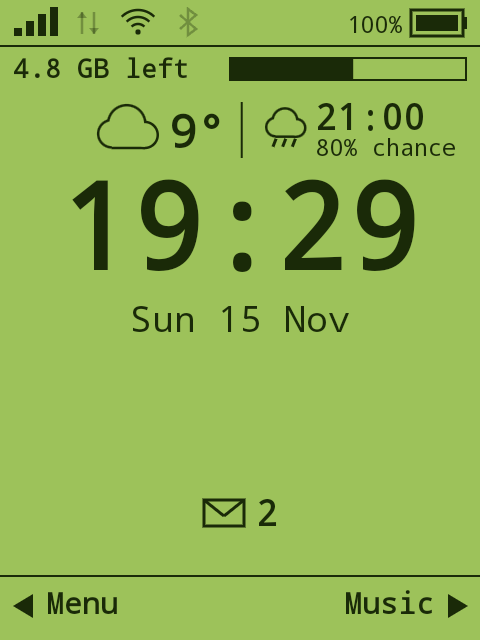
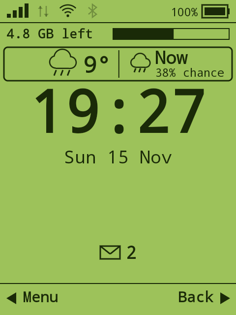
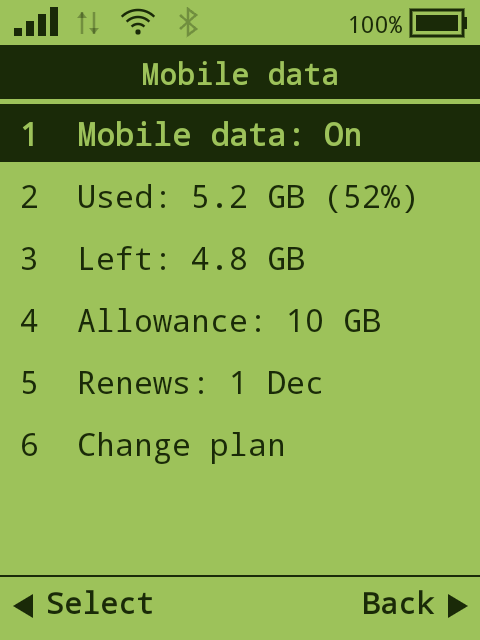
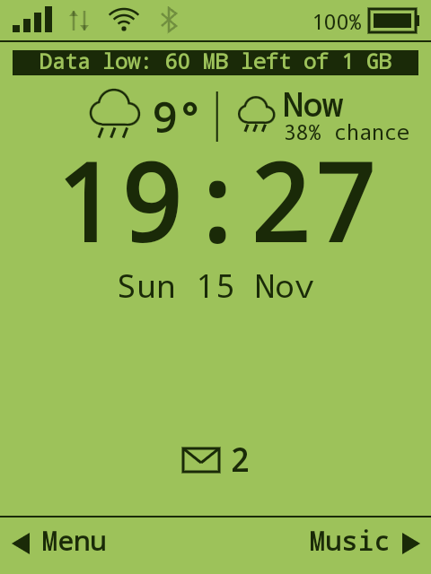
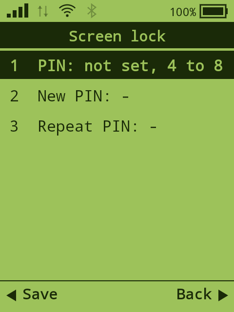

# Day to day: what your child sees, and what to do when

This page is for after setup. It shows the home screen on the Qin J36 (in the default green look) and what to do when something goes wrong. Everything in the pictures is real, taken from the phone's own software.

## The home screen

From the top:

1. **The status line:** signal, mobile data arrows, Wi-Fi, Bluetooth, battery.
2. **Mobile data left:** "4.8 GB left" with a bar for how much of the plan is used (see below).
3. **The weather:** today's weather and temperature on the left. On the right, **when rain is due**: the time it is expected and the chance ("21:00, 80% chance"), or **"Now"** if it is raining. On a dry day it says **"Dry"** with the day's high and low.
4. **The clock and the date.**
5. **The symbol row:** unread messages and missed calls, with counts. A music note appears while music plays.
6. **The soft keys:** **Menu** on the left, **Music** on the right.

While music or radio plays, a line with a play triangle and a scrolling "Artist - Title" appears under the date, with a progress bar. When nothing is playing that space shows the next calendar event, if there is one.

### Going straight to things with the Up key

Press **Up** on the keypad and a symbol on the home screen is outlined. **Up** and **Left** move to the previous symbol, **Down** and **Right** to the next, and **OK** opens what is behind it: the forecast, the data page, the Wi-Fi list, the Bluetooth list, or the messages. **End** or the right soft key goes back.

## Mobile data

The phone counts how much of the SIM's mobile data has been used this month, so you do not have to look it up. It is the phone's own count, so it can differ from your provider's. There is a correction setting for that.

Set it up once, on the phone: **Menu, Settings, Connections, Mobile data, Change plan** (on the keypad: **Menu, 9, 3, 3**, then the last row). Enter the allowance in GB and the day of the month the plan renews. If you set a **Correction** (in MB) the phone adds it to its own count, so the figure matches your provider.

When 10% or less is left (you can change this), the strip on the home screen turns into a dark banner:

You can turn the data strip off for any mode (for example School/work) on the parent page: **Timetable**, then **Mode settings**, then untick **Mobile data left on the home screen**.

## Screen lock (PIN)

Your child can set their own PIN on the phone, without going into Android's settings: **Menu, Settings, This phone, Screen lock** (on the keypad: **Menu, 9, 4, 1**). Enter the PIN (4 to 8 digits) twice and press **Save**.

You can also set, change or remove the PIN from the parent page: **The phone** tab, **Screen lock (PIN)**. A PIN you set replaces your child's, so you can always get back in. This works on **Family** phones. On an **Open** phone the same row opens Android's own screen, and a forgotten PIN means erasing the phone.

## When something goes wrong

**My child forgot their PIN.** Open the parent page, go to **The phone**, **Screen lock (PIN)**, and set a new one, or remove it. The phone picks it up at its next check-in (a few minutes). On an Open phone there is no way to recover it other than erasing the phone.

**The phone needs updating.** Open the parent page, go to **The phone**, **Updates and removals**, and press **Update this phone** if it is offered. The phone installs it at its next check-in and needs to be on Wi-Fi. "Allow updating" must be ticked on the same page. You can untick it again afterwards if you want to approve each update.

**The companion needs updating.** The parent page shows "A newer companion is available". On the computer you set up with, run the setup tool and choose **Update my companion**. Nothing is lost.

**I cannot get into the parent page.**
- Use **Sign in with a passkey** if this device has one.
- Otherwise open the private link you saved when you set up (it ends in `#k=` and a long key). That always works. See [signing in](sign-in.md).
- If you have lost both, the setup tool on your computer holds a copy in your home folder (`.phoneguard`).

**I lost my child's phone.** Open the parent page and look at the **Today** tab for where it was last seen. The phone also keeps working under your rules while it is lost.

**New phone.** Open the parent page and press **Add a phone**, then follow [getting started](getting-started.md) to install on the new J36.

**The home screen shows no data strip or no weather.**
- The data strip needs a plan set on the phone (above), the SIM inserted, and the mode must have the setting ticked.
- The weather needs a place set on the parent page (**Services** tab, **Weather place**). Without one the weather and rain indicator are hidden.
