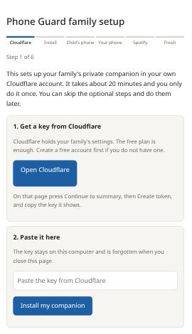
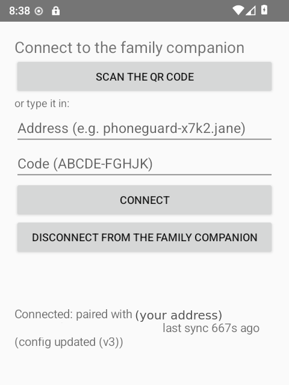
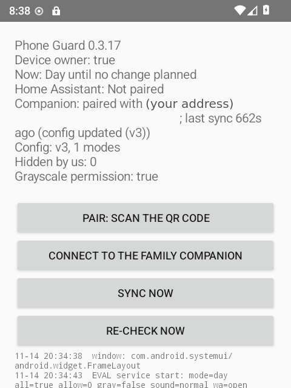
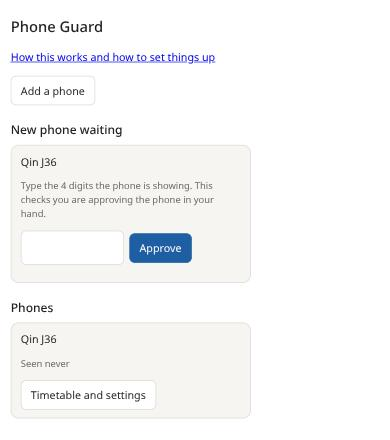
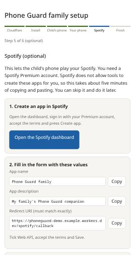
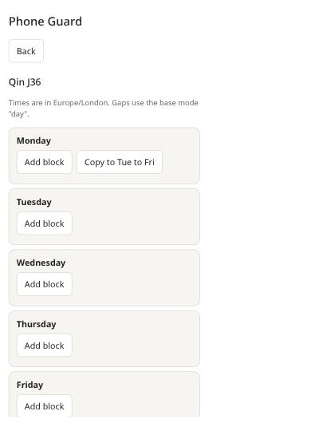

# Family setup: your own Phone Guard companion

This guide takes you from nothing to a child's phone managed from your own phone, with no Home Assistant and no service run by the Phone Guard project. Allow about 30 minutes the first time.

> **Status.** The setup tool described here is a working prototype, tested on a Qin J36 with a real Cloudflare account. It is run from source with Node.js today; a one-file download for Windows, Linux and macOS is planned. The tool does not flash the phone yet: the phone must already be running the Phone Guard image (see [Before you start](#before-you-start)). Items marked *not yet* are listed under [Known limits](#known-limits).

## What you will end up with

* A small private service (a Cloudflare Worker with its own database) in **your own** Cloudflare account. It holds your family's settings and passes them to the phone.
* The child's phone checking in about every 15 minutes and following your timetable. If it loses internet it keeps the last settings.
* A private page on **your own phone** where you approve phones, edit the timetable and connect Spotify.

You own the Cloudflare account, the data in it and the responsibilities that come with it. The Phone Guard project never sees your settings or your keys.

## How the pieces fit

| Part | Where it runs | What it does |
|---|---|---|
| Setup tool | your computer, once | creates the service in your Cloudflare account and makes the pairing codes |
| Companion (Worker + database) | your Cloudflare account | holds settings, relays them, serves your parent page |
| Child's phone | Phone Guard app | pairs, checks in, follows the timetable |
| Your phone | any browser | opens your private link to approve phones and change settings |

Passwords and tokens for connected services (Spotify, later email) are locked in your browser so that only the child's phone can unlock them. Your Cloudflare account only ever holds the locked copy.

## Before you start

You need:

1. **A Qin J36 running the Phone Guard image.** If it is still a stock phone, start with [Start here](getting-started.md): it covers unlocking the bootloader, flashing and first start, then brings you back here. The image is published as a [GitHub release](https://github.com/durkimat/phoneguard/releases/tag/image-20261114) for J36 owners (personal use; the licence questions are still being answered, see [licensing](licensing.md)); the [installer](../installer/README.md) downloads it for you. You can also build it yourself: the recipe is in `build/` and [build-it-yourself](build-it-yourself.md), and flashing is described in [recovery-guide](recovery-guide.md). Building takes a Linux machine with about 300 GB of disk and several hours.
2. **A computer** (Windows, Linux or macOS) with [Node.js](https://nodejs.org) 20 or newer and `git`.
3. **A free Cloudflare account.** Sign up at <https://dash.cloudflare.com/sign-up>. You do not need a domain or a payment card.
4. **Your own smartphone** with a camera and a normal browser.
5. *(Optional)* **A Spotify Premium account** if you want Spotify on the child's phone. The owner of the Spotify developer app must have Premium.

## Get the tool

```bash
git clone https://github.com/durkimat/phoneguard.git
cd phoneguard/companion/setup-tool
npm run bootstrap
npm start
```

`bootstrap` installs what is needed and builds the Worker (internet needed, about a minute). `npm start` opens the **setup wizard** in your browser. It only works on this computer.

## The setup wizard

The wizard shows a progress bar along the top ("Step 3 of 9"). It does everything it can by itself. Where it cannot, it hands over with a link and exact values to copy. Optional steps have a **Skip** button, and you can do them later from your parent page.

### Step 1: Cloudflare

1. Press **Open Cloudflare** and sign in (or create a free account) when asked.
2. You arrive at "Create API token" with the permission already chosen (Workers Scripts: Edit). **Change nothing on that page.**
3. Scroll to the bottom, press **Continue to summary**, then **Create token**.
4. Cloudflare shows the key once. Press **Copy**, paste it into the wizard, press **Check my key** (it shows which Cloudflare account it can use), then **Install my companion**.


*The wizard's first step: get the Cloudflare key, then paste it. The progress bar shows where you are.*

The key stays on your computer, is used only to talk to Cloudflare and is forgotten when you close the page. Afterwards you can delete it in Cloudflare (your profile, API Tokens); you make a new one when you update. If you have already installed your companion and closed the wizard, pick it under **Continue an earlier setup** to carry on from step 3.

### Step 2: Install

Automatic. A checklist shows: checking your account, preparing your address, installing the companion, waiting for it to come online (this can take two minutes while Cloudflare prepares the secure address), making the code for the child's phone. If your key can see more than one Cloudflare account, the wizard asks which one to use. A copy of your parent key is saved in `~/.phoneguard/` on your computer.

### Step 3: Connect the child's phone

The wizard shows a QR code and an address and code to type instead. They work for about 10 minutes; **Make a new code** gives a fresh one.

1. On the child's phone open **Phone Guard**, then press **Connect to the family companion**.
2. Scan the QR code, or type the address and the code and press **Connect** (or the keyboard's Done key).
3. The phone shows a 4-digit number. The wizard notices the waiting phone and asks you to **type those 4 digits** and press **Approve**. Typing them checks that you are approving the phone in your hand and not a stranger's.
4. A **recovery key** appears once. Write it down and keep it somewhere safe, not on the same phone. Tick the box to continue.
5. The wizard says when the child's phone has connected, usually within about 10 seconds. The phone's status page then says **Companion: paired**.


*The phone's enrol screen: scan or type, Connect, and Disconnect. Once paired it shows the connected line at the bottom.*


*The phone's status page showing the Companion line after pairing.*

You can skip this step and add a phone later with **Add a phone** on your parent page.

### Step 4: Your phone

The wizard shows a QR code for your **private parent link**. Scan it with your own phone's camera; it opens your parent page, already signed in. Anyone who has this link can manage your phones, so do not share or post it. You can skip this and use the link later (the wizard's last page shows it again).


*Your parent page: add phones, approve new phones, see your phones.*

### Step 5 (optional): Spotify

> **The child's phone needs the Spotify app.** It is not part of the Phone Guard image (Spotify only publishes it on Google Play), so install it once: [installing Spotify on the phone](install/spotify-app.md). The wizard shows whether the phone has reported it.

Spotify does not let tools create developer apps or add users for you, so this step is a guided hand-off. It takes about five minutes, needs a Spotify Premium account, and you can **Skip** it and do it later.

1. Press **Open the Spotify dashboard**, sign in with your Premium account, accept the terms and press **Create app**.
2. Fill in the form with the values the wizard shows, each with a **Copy** button: app name, app description and the **redirect URI**. The redirect URI must match exactly. Tick **Web API** and save.
3. In the app's Settings open **User management** and add the email address of every Spotify account that will be used (Spotify allows up to five).
4. Copy the app's **Client ID** from its Settings and paste it into the wizard. It says "Looks right" when it has 32 letters and numbers.
5. Press **Save and connect Spotify**. A new tab opens on your parent page; sign in to Spotify there. The wizard ticks when Spotify is connected.


*The Spotify step hands off with the exact values to copy.*

The sign-in key is locked in your browser so that only the child's phone can open it. The phone collects it at its next check-in. If you skipped this step, do it later from your parent page: **Timetable and settings**, then the Spotify box.

### Step 6 (optional): Email

This lets the child's phone send and receive email with a normal mail account, on its own simple screens. Use an address made for the child and not your own. It takes about five minutes, and you can **Skip** it and do it later.

1. Type the **email address**. For Gmail, iCloud and Fastmail the wizard fills in the server settings and shows the steps for getting an **app password**: a separate password just for this phone, which you can cancel at any time. Other providers need their incoming (IMAP) and outgoing (SMTP) server names. **Microsoft addresses (Outlook.com, Hotmail, Live) cannot be used yet**, because Microsoft no longer accepts passwords for mail apps; the wizard says so.
2. Paste the **app password**.
3. Press **Check it works**. The wizard signs in to the incoming and outgoing servers from your computer and tells you in plain words if something is wrong (wrong password, wrong server name, and so on).
4. Press **Send to the phone**. The password is locked on your computer so that only the child's phone can read it. The phone sets the account up at its next check-in (up to 15 minutes, or press **Sync now** on the phone), and the wizard shows when it has.

You can also do this later from your parent page: open the phone, then **Email**.

### Step 7 (optional): Calendars

This shows your family calendars on the child's phone, **view only** (events the child adds on the phone stay on the phone). You can **Skip** it.

1. Get each calendar's **private iCal link**. In Google Calendar on a computer: Settings (the cog), the calendar's name under *Settings for my calendars*, then *Integrate calendar* and copy the **Secret address in iCal format**. Other calendar services have a similar iCal, ICS or subscribe link. Anyone with the link can read that calendar, so treat it like a password.
2. Paste it and press **Check the link**. The wizard reads it and tells you how many events it found.
3. Give it a name and press **Add this calendar**. The link is locked so only the child's phone can read it. Add as many as you like (up to eight).

You can also do this later from your parent page: open the phone, then **Calendars**.

### Step 8 (optional): WhatsApp

This lets the child's phone read and send WhatsApp messages through its own simple screens, with only the people you choose. Messages stay on the phone. The phone becomes a "linked device" of one WhatsApp account, like WhatsApp Web, so you need the smartphone that has that WhatsApp account (the child's own number, or yours). You can **Skip** this step and do it later.

1. **Choose who the child may message first.** Nobody is allowed until you do. Tick "Allow everyone and every group", or type one per line a phone number with country code and no plus, or `g:` and a group's name (`g:Family`), and press **Save who is allowed**. Do this before linking, and wait until the wizard says the child's phone has your choice (the link steps are greyed out until then; press **Sync now** on the phone to speed it up): WhatsApp sends a month of recent chats to the phone only once, at the moment it is linked, and the phone keeps only the chats you allow. You can change it later on the parent page, but older messages will not come back unless you link again.
2. **On the child's phone** open the pairing screen: Messages, then WhatsApp (or Settings, then WhatsApp; Messages only offers WhatsApp when the current mode allows WhatsApp checks). It is called **Link WhatsApp** and asks for **Your WhatsApp number**: type it with the country code and no plus (for example `447700900123`) and press **Get code**. The phone shows a code.
3. **On the smartphone that has that WhatsApp account** open WhatsApp, then Settings (or the three dots), **Linked devices**, **Link a device**, **Link with phone number instead**, and type the code. (If you are reading the wizard on a computer and doing this on a smartphone, the wizard has a "open these steps there" link with a QR code.)
4. The child's phone says **Linked**, and the wizard ticks once the phone has told your companion (at its next check-in, up to 15 minutes, or press **Sync now** on the phone).

To unlink and link again, use **Unlink** in the phone's WhatsApp settings. If you remove the linked device from your own WhatsApp first, the phone detects that, clears itself, and offers a new link.

WhatsApp can lapse a linked device if the main smartphone has not been online for about two weeks; if messages stop, link again from step 1. The same steps are on your parent page at `/guide#whatsapp`.

### Step 9: Finish

**Setup finished.** A summary shows what is done and what you skipped, with how to do each skipped part later, plus a button to open your parent page. From here on you manage the phone from that page, not from the wizard.

## Set a timetable

Do this on your parent page after the wizard.

1. Press **Timetable and settings** under the phone.
2. For each day add blocks (start, end, mode). **Copy to Tue to Fri** saves typing. Gaps use the base mode.
3. Press **Save**. The phone picks it up at its next check-in, or immediately if you press **Sync now** on the phone.


*The timetable editor.*

Times follow the time zone shown on the page, including clock changes. The page works out the next 14 days; the phone does no calendar logic and keeps repeating your weekly pattern if it is offline for longer.

## Everyday controls

Your parent page opens on the phone's status: what it is doing now, battery, when it was last seen, **where it was last seen**, screen time today and WhatsApp. Below that are tabs: **Today** (force a mode, boost, location history, screen time, battery), **Timetable**, **Apps**, **Services** (WhatsApp, Spotify, email, calendars, radio, weather) and **The phone** (look, updates, manage). Each section opens and closes; every control saves straight away and the phone picks the change up at its next check-in (about 15 minutes), or at once if you press **Sync now** on the phone.

| Section | What it does |
|---|---|
| **Right now** | Force a mode regardless of the timetable, give a temporary **boost** (up to 3 hours, pressing again adds time), set **holiday** dates (School/work becomes Day). |
| **Timetable** | The weekly blocks, the base mode for gaps and the time zone. |
| **Apps and modes** | A tick grid of which apps each mode allows, with select-all. New apps appear for you to **approve** or leave blocked. A **Remove** button asks the phone to uninstall an app. |
| **Mode settings** | Per mode: grey screen, home screen, touch, pull-down shade, sound, WhatsApp checks and app, internet radio, radios sleeping, incoming calls, camera, location and how often, notifications, locking to allowed apps, screen-off and idle times, allowing new apps automatically. |
| **Phone restrictions** | Factory reset, safe mode, date and time, adding users, VPN and other Android settings the phone may block. |
| **WhatsApp**, **Radio stations**, **Apps on the Nokia menu**, **Weather place** (type a postcode or town), **Look of the phone** | Who WhatsApp may talk to and how fast, your station list, which apps are in the main menu and which notifications are cleared, the weather location, and the phone's theme, fonts and colours. |
| **Spotify** | Connect or disconnect (see above). |
| **Email**, **Calendars** | Set or change the child's mail account (with an app password) and the family calendars shown on the phone. Passwords and private calendar links are locked so only the phone can read them. |
| **Location history** | Where the phone has been over the last week (you choose 1 to 14 days, or off), played back on a map: pick a day and press Play. Quiet stretches such as school or home play fast and journeys play slowly so movements are easy to follow; the stops list ("Stayed 08:19 to 15:03") jumps to each stay. Positions are kept only in your Cloudflare account and can be cleared at any time. Location must be switched on for a mode first (Mode settings, Location). |
| **Screen time**, **Battery and power saver** | What the phone reported: app time per day, battery use by screen, mode, location and Wi-Fi, and what the power saver closed. The latest position is shown at the top with a map link. |
| **Updates and removals** | Shows the companion's version, switch on updating Phone Guard from here, check GitHub for the newest release, update a phone, and see waiting and finished jobs. See [updating](updating.md). |
| **Manage this phone** | Rename, copy timetable, holiday, restrictions, mode settings or WhatsApp from another phone (app lists are never copied), release the phone (it gives up control) or forget it. |

Other everyday jobs:

* **Update your companion or a phone:** a notice appears at the top of your parent page when a newer companion is available. See [updating](updating.md). Nothing is lost and nobody has to pair again.
* **Add another phone, or the code ran out:** press **Add a phone** at the top of the parent page.
* **Start again with the same phone:** on the phone's enrol screen press **Disconnect from the family companion**, then connect again. Secrets sealed before a disconnect will not open afterwards, so reconnect Spotify.

## Privacy, cost and limits

* **Where data lives:** timetable, phone model, battery level, current mode and the app version are in your Cloudflare account. No location history or messages are stored by the companion.
* **Cost:** the free Cloudflare plan is enough. A phone checking in every 15 minutes is about 100 requests a day; Cloudflare's free allowance is far larger. Check Cloudflare's current limits if you add many phones.
* **Your responsibility:** you are the account owner and, in data protection terms, responsible for the data in it. Read Cloudflare's terms for your account.
* **Open source:** all code is in this repository under Apache-2.0.

## Troubleshooting

| Symptom | What to try |
|---|---|
| Cloudflare "did not accept that key" | Create the key again with the button in the wizard. Check you chose Workers Scripts: Edit. |
| Setup waits a long time on "online" | A new Cloudflare address can take up to two minutes. If it stops after that, close the wizard, run `npm start` again and retry. |
| Phone says "token invalid or expired" | Codes last 10 minutes and work once. Press **Make a new code** in the wizard, or **Add a phone** on your parent page. |
| Digits do not match | Check you typed what the **child's phone** shows. After three wrong tries ask the phone for a new code. |
| Phone is not paired after approval | Check the phone has internet. Press **Sync now** on its status page and read the Log line at the bottom. |
| Parent page asks for a key | Open your private link again (wizard step 4, or the saved file in `~/.phoneguard/`). |
| Spotify says "invalid redirect URI" | The redirect URI in the Spotify dashboard must match the one the wizard shows exactly, including `https://` and the path. |
| Spotify signs in but nothing plays | Your Spotify account must be added under Users and Access, and the app owner needs Premium. |

## Removing everything

* On the phone: **Disconnect from the family companion**.
* In Cloudflare: delete the Worker named `phoneguard-…` (Workers and Pages in the dashboard), or run `CF_TOKEN=<key> node cli.mjs delete <name>` in the setup tool folder.
* On your computer: delete `~/.phoneguard/`.
* In Spotify: remove the developer app and revoke access in your account settings.

## Known limits

* The tool does not flash the phone (*not yet*).
* Sign-in to Cloudflare uses a key you create from a link rather than a "Sign in" button (*not yet*).
* If you lose your private link, there is no recovery flow yet (*not yet*): re-run setup to create a new companion and pair the phones again.
* Changes reach a phone at its next check-in, about 15 minutes (Home Assistant could nudge a phone with a notification; Cloudflare has no push yet).
* Email and calendars are set up from the wizard or the parent page, but the phone has to be running a build that picks them up (an older build ignores them). Calendars are view only, with no write-back to Google; Microsoft mail addresses are not supported yet.
* The timetable, Spotify and WhatsApp linking work today (WhatsApp is a guided hand-off).
* Location history has no named places (home, school) or alerts yet; they are planned.
* A packaged download for Windows, Linux and macOS is planned; today you run it with Node.js.
